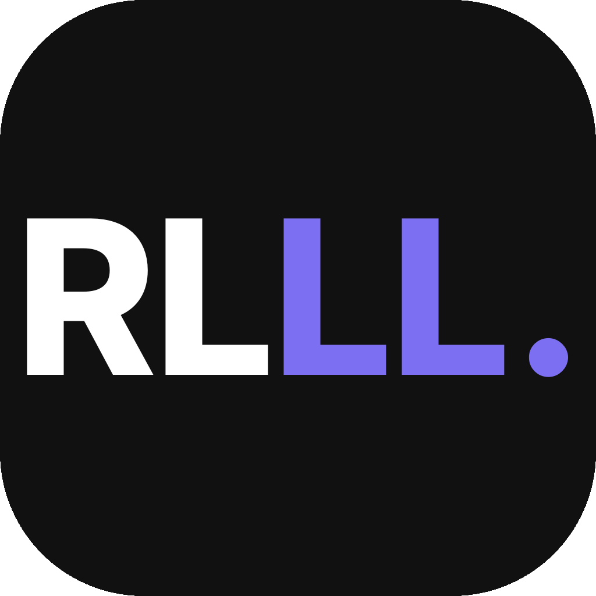
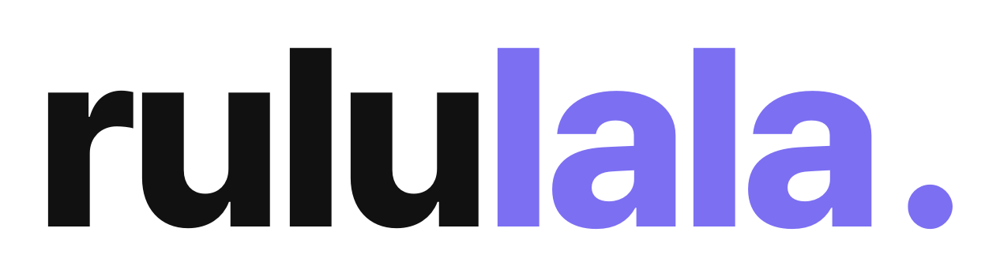

# rululala 디자인

## 로고

**작은 로고** — 검정 둥근 정사각형에 `RLLL.` (RL 흰색, LL과 점 보라)

**큰 로고** — `rululala.` (rulu 검정, lala와 점 보라)

투명 배경 원본: [icon.png](assets/icon.png), [wordmark.png](assets/wordmark.png)
SVG 원본: [icon.svg](assets/icon.svg), [wordmark.svg](assets/wordmark.svg)

## 색상

- 보라 `#7C6FF2`
- 검정 `#111111`
- 흰색 `#FFFFFF`

## 서체

- Pretendard ExtraBold
